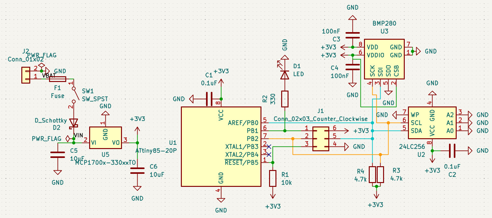
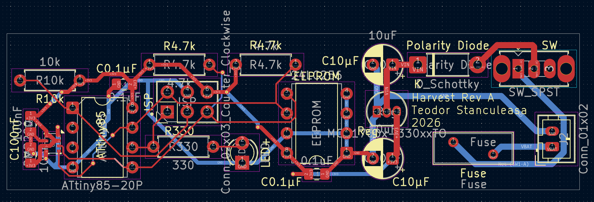
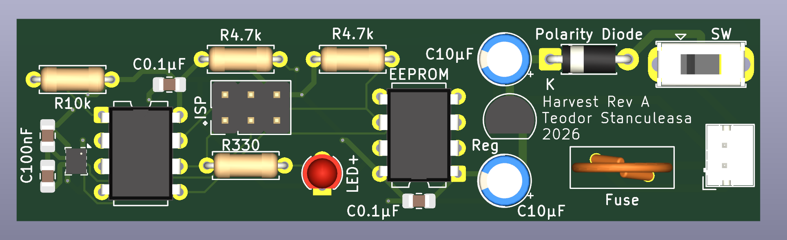
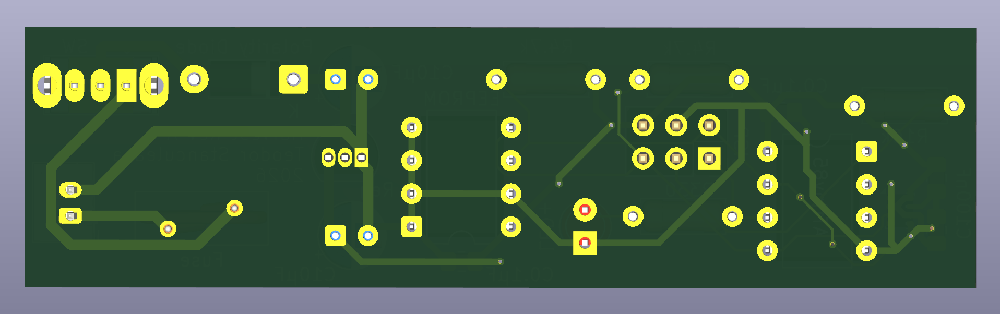

# HARVEST

## PROJECT OVERVIEW

Harvest is a battery-powered environmental data logger.

## DESIGN GOALS

This project was designed with the goals in mind to learn PCB design. The design choices were made to assure the schematic and wiring are simple, the board is easy to assemble, parts are easy to find online and to teach me as much as possible.

Project Status: **RETIRED**

## DESIGN REQUIREMENTS

- Log pressure and temperature
- Run from a small LiPo battery
- Store measurements in EEPROM
- Have a simple design
- Be easy to assembly
- Use mostly THT components

## QUICK SPECS

**Sensing**: time, air pressure & temperature  
**Sample Rate**: 50 Hz  
**Max Running Time until Full**: 51 seconds  
**Size**: 73x20 mm  
**Weight**: 8 grams   
**Battery Life**: ~38 hours (250 mAh LiPo)  

## HARDWARE

### MCU 

    ATtiny85-20PU

    ATtiny85-20PU speeds at different voltages:
    0-10 MHz at 2.7 - 5.5V, 0-20 Mhz at 4.5 - 5.5V

    It was chosen because it has a small amount of pins, making the routing process easier.

### SENSORS

    BMP280

    It was chosen because of extended support and ease of use.

### STORAGE

    24LC256-I/P

    It was chosen because it has enough storage capacity and comes in an easy to manage (THT) package.

### POWER

    -- 3.3V Voltage regulator:
        MCP1700-3302E/TO

        Easy to find, very popular and 3.3V. Efficient LDO with low quiescent current.

    -- Electrolytic Capacitor:
        ECE-A1EKS100I

    -- Ceramic Capacitors:
        CML0805X7R104KT50V

    -- Schottky Diode:
        1N5817

    -- 330 Ohm Resistor:
        CF1/4CT52R331J

    -- 4.7K Ohm Resistor:
        RNMF14FTC4K70

    -- 10K Ohm Resistor:
        CFR-25JB-52-10K

    -- PTC Fuse:
        MF-R020

### ADDITIONAL COMPONENTS

    -- Red LED:
    	TLHR4205
        
    -- Switch:
        OS102011MS2QN1C

    -- Connector JST-PH 2.00mm
        B2B-PH-K-S

## SCHEMATIC DESIGN

● Data line  
● Clock line  
## PCB DESIGN

  

| Trace Function               | Width (mm) |
|------------------------------|------------|
| Input power (board supply)   | 0.8        |
| Regulated power rail         | 0.5        |
| Signal/logic lines           | 0.2        |

## 3D VIEW

## ASSEMBLY

The assembly consisted of preparing the PCB by applying the solder paste on the pads, placing the SMD components and then using a hot plate soldering them. The first time that I applied the solder paste, I did it without the stencil, as I had not ordered one yet, it was definitely quite challenging to make an accurate application, I ordered one after. When trying the hot plate, I was a little surprised that nothing was happening, even when the hot plate reached the advertised temperature of the paste at 137°C. Only when I set it to 165°C did it actually melt the paste. After letting the PCB cool down for a moment I went on to solder the rest of the THT components. The order was: resistors, polarity diode, SOIC chips (MCU and EEPROM), LED, Regulator and capacitors, switch, battery connector and last the fuse. I went from lowest to highest components.

At the end, the board was cleaned with electronics spray and a microfiber cloth.

## FIRMWARE ARCHITECTURE

**The use of a pre-made I2C driver was not possible, since a good one was not found.**

Custom big-banged I2C implementation using the ATtiny85's USI hardware as shift/clock helper.

This I2C driver handles:

- start/stop
- read/write bytes
- ACK/NACK
- device addressing

The program would initialize the sensor and EEPROM, read raw 12 byte data from the sensor and then store the raw values on the storage. The data would have later been processed on a PC. This was chosen to simplify the code and to minimize the work that the MCU has to do. 

**Buffer**:
    
    The buffering strategy was to store the samples in RAM and write 5 entries at once into one EEPROM page. This was done to reduce EEPROM overhead and keep timing stable.

**Timing model**:

    While the intended sampling rate was 50 Hz or 20 ms, that was implemented as timestamp increments, not controlled by a hardware timer. The loop would run continuously as fast as the sensor and I2C layer would allow. The timing was logical, nost strictly 
    enforced in real time.

### OUTCOME

**I²C communication issues (likely related to routing and/or software implementation) prevented reliable communication with both the BMP280 sensor and the EEPROM, resulting in incomplete system operation.**

## METRICS

| Metric                       | Value          |
|------------------------------|----------------|
| Entry size                   | 12 bytes       |
| Entries per page             | 5              |
| Bytes written per page       | 60             |
| Available pages              | 511            |
| Total entries stored         | 2555           |
| Theoretical write rate (/sec)| 10             |
| Logging duration before full | 51.1 seconds   |
| Average current (estimated)  | ~6.5 mA        |
| Battery life (theoretical)   | ~38 hours      |

**Technical note**: Since the timing was not physically guaranteed, the metrics are a best case scenario and calculated, not measured.

## BOM

|        Part        | Quantity | Price |
|--------------------|:--------:|:-----:|
|   ATtiny85-20PU    |     1    |  1.42 |
|      BMP280        |     1    |  1.38 | 
|    24LC256-I/P     |     1    |  0.99 | 
|  MCP1700-3302E/TO  |     1    |  0.43 | 
|   ECE-A1EKS100I    |     1    |  0.15 | 
| CML0805X7R104KT50V |     4    |  0.04 | 
|       1N5817       |     1    |  0.20 | 
|   CF1/4CT52R331J   |     1    |  0.09 |
|    RNMF14FTC4K70   |     2    |  0.03 |
|   CFR-25JB-52-10K  |     1    |  0.02 |
|       MF-R020      |     1    |  0.29 |
|      TLHR4205      |     1    |  0.39 |
|   OS102011MS2QN1C  |     1    |  0.67 |
|     B2B-PH-K-S     |     1    |  0.09 |
| Total              |          |  6.34 |

**BOM excludes taxes, shipping, and vendor pricing**

## Procurement Cost

|     Category (With TAX)     | Price |
|-----------------------------|-------|
|          Components         |  7.61 |
|        PCB fabrication      |  1.23 |
| Total                       |  8.84 | 

## PROBLEMS ENCOUNTERED

**Project Context**

    Everything done in this project was new to me, from the design, to choosing the right parts, to SMD soldering and to embedded programing. During the design, I choose to skip stages like breadboard testing and prototype boards in favor of getting to the actual PCB design stage faster, since that was the main goal. I decided to attempt a lot of new disciplines simultaneously by choice.

### 1 ISSUE

**Insufficient debugging capability**
    
    The board only had one red LED. With that, only basic feedback in the form of timed blinks was possible, making it somewhat complicated to understand/gauge the problem at times and the origin of the problem/failure.

    -- Solution:
        Future designs should include multiple LEDs and even DEBUG PADS.

### 2 ISSUE

**Discontinued parts**

    One part was discontinued even before I started the design, but I forgot/didn't think to check(didn't even cross my mind, as I wasn't yet at that level) this before making my design around it. This created some difficulties in getting that part. Multiple solutions were considered, as changing out for a very similar part (in function and footprint), but in the end, the solution chosen was to buy carrier boards that had that part, "scavenge" it off and solder it onto my PCB.

    -- Solution:
        In the future, parts availability should be checked before part selection is finalized.

### 3 ISSUE

**Programming header was routed incorrectly**

    The AVR ISP 6 Pin 2x3 header was routed incorrectly, not following the standard AVR ISP standard. Thus, standard programmers like a "USBasp" were not compatible with the PCB and could not be used. The solution was custom wiring using jumper wires from an Arduino UNO R3 to the right pins of the header.

    -- Solution:
        Headers used for programming or data acquisition should be planned more thorougly and more thought should be put into the design chosen. Additionally, the existing standards for Pin arrangement/routing should be followed closely.

### 4 ISSUE

**No mounting holes**

    At the end of the PCB design process, it was decided to skip mounting holes to avoid largening the PCB, giving it a non-standard shape and also not redesign it.

    -- Solution:
        Add mounting holes in the future.

### 1 ARCHITECTURAL LIMITATION 

**Having to program an I2C layer**

    Since the ATtiny85 doesn't have hardware I2C support, a custom implementation was needed. A Software-driven I2C with USI used as a shift register/timing aid was used. This meant that most of the time spent on the firmware for Harvest, was actually spent getting the I2C protocol to work.

    --Solution:
        Use MCUs that support every feature needed natively. It will save time and effort over make-shift solutions.

### 2 ARCHITECTURAL LIMITATION

**EEPROM too limited in size**

    The EEPROM chosen only allows for 2555 entries stored. At a sampling rate of 50Hz, that would fill it up in a little over 50 seconds.

    -- Solution:
        Pick a flash storage bigger in storage capacity.

## WHAT WORKED

Power delivery was designed with reverse-polarity protection, short-circuit protection, a power cutoff switch and trace widths adapted to their specific current requirements.

- Components sourced successfully  
- Board assembled successfully  
- MCU programmable  
- Power delivery functional  
- SMD soldering successful  
- Schematic manufacturable  
- Good PCB components labeling on the silkscreen  

## WHAT DIDN'T WORK

- Difficult I2C debugging
- Insufficient observability/feedback
- Complicated programming process
- MCU too constrained

## LESSONS LEARNED

### HARDWARE

- Add test/debug pads (communication and power)
- Add mounting holes
- Use stronger battery connectors
- Follow header/pin wiring/routing closely
- Add more LEDs (different colors)
- Add activity LED
- Add power status LED
- Add buttons
- Have a bigger portion of the PCB be SMD soldered (nicer process and makes the board smaller)
- Use MCU with native hardware support for communication protocols
- Use QSPI Flash

### FIRMWARE

- Add tests/diagnostics early
- Add more comments

### PROCESS

- Validate subsystems separately
- Design debugging features **BEFORE** ordering PCB

## TOOLS USED

### SOFTWARE

- KiCAD

### HARDWARE

- Soldering iron
- Hot plate
- miscellaneous stuff (tweezers, pliers, magnifiying glass,...)

### ADDITIONAL

The PCBs were manufactured by JLCPCB, simply because they had the lowest price.

The parts were ordered from DigiKey. I tried to buy all the components from the same vendor. The only thing bought from a different vendor (Amazon), were the carrier boards for the scavenged BMP280.

## REASON FOR RETIREMENT

    The project successfully achieved it's educational goals. Development stopped in favor of a new architecture based on lessons learned.